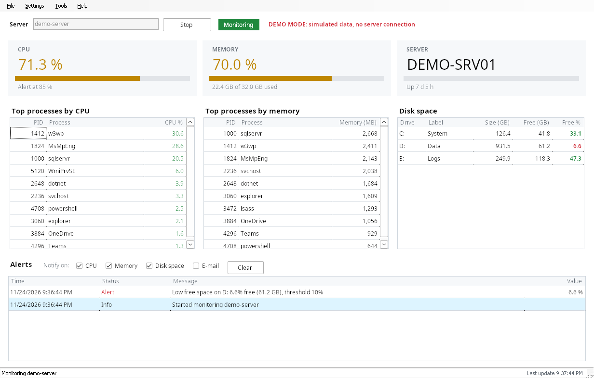

# Monitoring Tool (PowerShell)

A Windows desktop tool that monitors a remote Windows server over PowerShell remoting (WinRM):
CPU and memory usage, top processes by CPU and by memory, free disk space, plus **custom checks
written as plain PowerShell scripts**, with in-app and e-mail alerts.

Nothing has to be installed on the monitored server: every metric and check is a script that
the tool runs there over remoting, on its own schedule.

Built on **.NET 10** (WinForms) and the **PowerShell 7.6 SDK**.



*Screenshot taken with `MonitoringTool.exe --demo`, which shows simulated data without connecting
to a server. It was captured under Wine (no window frame, substitute font), so it looks slightly different on Windows.*

## Requirements

**On the machine running the tool**

- Windows 10/11 or Windows Server 2016+
- [.NET 10 Desktop Runtime](https://dotnet.microsoft.com/download/dotnet/10.0)

**On each monitored server** (elevated PowerShell):

```powershell
Enable-PSRemoting -Force
```

If the server is not in the same Active Directory domain as the machine running the tool,
add it to the client's trusted hosts (elevated, on the machine running the tool):

```powershell
Set-Item WSMan:\localhost\Client\TrustedHosts -Value 'server01' -Concatenate
```

Your account must be an administrator, or a member of *Remote Management Users*, on the
server. `Test-WSMan server01` and `Enter-PSSession server01` should both work before you
start the tool. The same text is under **Help → Remote server setup** in the app.

## Usage

1. Type a server name or IP address and press **Start** (or Enter).
2. CPU and memory refresh every 10 s, processes every 15 s, disks every 2 min (configurable
   under **Settings → Polling**).
3. Use the **Notify on** check boxes above the alert list to turn alert types on or off;
   thresholds and repeat intervals are under **Settings → Alerts**.
4. For e-mail alerts, configure **Settings → E-mail server** and use **Send test e-mail**.

To try the UI without a server, start it with `MonitoringTool.exe --demo`
(or `dotnet run --project src/MonitoringTool.App -- --demo`).

An alert is shown when a threshold is crossed. While the condition lasts it is repeated every
*N* minutes (separately for in-app and e-mail), and a *Resolved* entry follows when the value
goes back below the threshold.

Settings are stored in `%LOCALAPPDATA%\MonitoringTool\settings.json`; the SMTP password in that
file is encrypted with Windows DPAPI for the current user. Logs are written to
`%LOCALAPPDATA%\MonitoringTool\logs` (**File → Open log folder**).

When v2 starts for the first time, it imports the v1 `AlertsConfigFile.txt` and `configSMTP.txt`
files if it finds them next to the executable or in the working directory. Once the settings
are imported, you can delete the old files. `configSMTP.txt` contains your SMTP password in
plain text.

## Custom checks

A custom check is a `.ps1` file. The tool runs it **on the monitored server** on its own
schedule and shows the result on the **Checks** tab. A check that reports Warning or Critical
raises an alert, like the built-in thresholds do. It can also send e-mail.

Built-in checks (in `Checks/` next to the exe):

| Check | Default interval | Reports |
|---|---|---|
| Stopped automatic services | 5 min | Critical when an *Automatic* service is not running (known noisy ones are ignored) |
| Failed scheduled tasks | 15 min | Warning for non-Microsoft tasks whose last run failed |
| Expiring certificates | 6 h | Warning when a certificate expires in 30 days or less, Critical when 7 days or less or already expired (LocalMachine\My, with a private key) |
| Pending reboot | 30 min | Warning when Windows Update, servicing or file renames need a restart |
| System log errors (last hour) | 10 min | Warning when there are Error events, Critical when there are Critical events |

### Writing your own

1. **Settings → Open custom checks folder** opens `%LOCALAPPDATA%\MonitoringTool\checks`.
2. Copy `_template.ps1` to a new name without the leading underscore. Files starting with `_`
   are ignored.
3. Edit it, then press **Reload checks** on the Checks tab. You don't need to restart or
   reconnect.

```powershell
# @name: Print spooler
# @description: The print spooler service must be running.
# @interval: 300      # seconds between runs (10 – 86400, default 300)
# @timeout: 60        # the script is stopped after this many seconds (5 – 600, default 60)

$service = Get-Service -Name Spooler -ErrorAction Stop
if ($service.Status -eq 'Running') {
    [pscustomobject]@{ Status = 'Ok'; Message = 'Spooler is running' }
} else {
    [pscustomobject]@{ Status = 'Critical'; Message = "Spooler is $($service.Status)" }
}
```

**Output contract:**
- **Objects with properties:** `Status` (`Ok`, `Warning` or `Critical`), `Message` and an
  optional numeric `Value`. When a script emits several objects, the worst status wins and the
  problem messages are combined.
- **Booleans:** `$true` means Ok, `$false` means Critical.
- **Plain strings:** shown as information, with status Ok.
- **No output:** Ok.
- **Script errors and timeouts:** the check shows as **Unknown**. Unknown never raises or
  clears an alert, so a broken script or a dropped connection doesn't cause alert noise.

A file in your folder with the same name as a built-in check replaces it. Each check can be
switched off with the **On** column. **Run now** runs the selected check immediately, even if
it is switched off, which is handy while writing one. Double-click a check to see its details
and the script path.

## Building

```powershell
dotnet build MonitoringTool.slnx
dotnet test --solution MonitoringTool.slnx
dotnet publish src/MonitoringTool.App -c Release -r win-x64 --self-contained false -o publish
```

The app project targets `net10.0-windows`. It can be *built* on Linux/macOS
(`EnableWindowsTargeting`), but it only runs on Windows. The core library and the tests run
on any OS.

## Project layout

```
src/
  MonitoringTool.Core/        platform-independent logic (unit tested)
    Models/                   SystemSummary, ProcessesSnapshot, DisksSnapshot …
    Settings/                 AppSettings records, JSON store, v1 importer
    Alerts/                   AlertEvaluator (raise / escalate / repeat / resolve), MailKit e-mail sender
    Checks/                   check script metadata parser, output contract, check library loader
    Monitoring/               MonitoringService: the job orchestrator, alert dispatch, e-mail queue
    Collection/               IMetricsCollector abstraction, host name validation
  MonitoringTool.App/         WinForms UI + Windows-specific infrastructure
    Forms/                    MainForm, ChecksPanel, SettingsForm
    Controls/                 MetricCard, UsageBar, GridView, Section, Theme
    Infrastructure/           PowerShell remoting collector, DPAPI, file logger
    Scripts/                  built-in metric scripts (embedded resources)
    Checks/                   built-in custom checks + _template.ps1 (copied next to the exe)
tests/
  MonitoringTool.Core.Tests/  xUnit v3
```

### Orchestration and threading model

`MonitoringService` is an orchestrator. Everything it runs against a server is a *job* with
its own schedule. There are three built-in metric jobs (CPU/memory, processes, disks) and one
job per custom check. Jobs only know how to collect. The orchestrator handles:

- **Scheduling:** each job runs on a `PeriodicTimer` and waits for its current run to finish
  before it waits for the next tick. A job therefore never overlaps itself, and a slow server
  never causes requests to pile up. Ticks missed during a slow run collapse into one catch-up
  run.
- **Concurrency:** custom checks share a limit (**Settings → Polling → Custom checks in
  parallel**, default 2). A large check library can't starve the built-in metrics.
- **Timeouts and failures:** every remote call has a timeout and can be cancelled. Metric
  failures mark the connection as *Problems*. Check failures become *Unknown* results instead.
- **Alerts:** a single state machine handles both thresholds and checks: raise, escalate from
  Warning to Critical, repeat per channel, resolve.
- **Lifecycle:** checks can be reloaded or run on demand without reconnecting. Stop cancels all
  running jobs.

Threading:

- The UI thread only handles UI. It never blocks: there are no `.Result`, `.Wait()` or
  `Thread.Sleep` calls in the app.
- Results reach the UI through a `Progress<T>` created on the UI thread, so every control
  update runs on the UI thread. Cross-thread checks stay enabled.
- The collector keeps a single WinRM runspace pool open for the whole session. It does not
  create a new `New-PSSession` for every metric. If the connection breaks, the collector
  reconnects. Every remote call can be cancelled and has a timeout.
- E-mails are sent from a background queue with async MailKit. A slow SMTP server never
  delays any job.
- The PowerShell scripts shipped with the app are syntax-checked by the unit tests with the real
  PowerShell parser, so a broken script fails CI instead of failing on a server.
